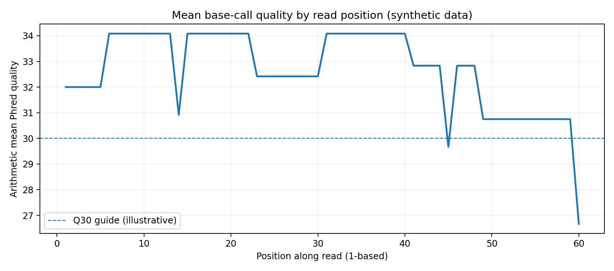
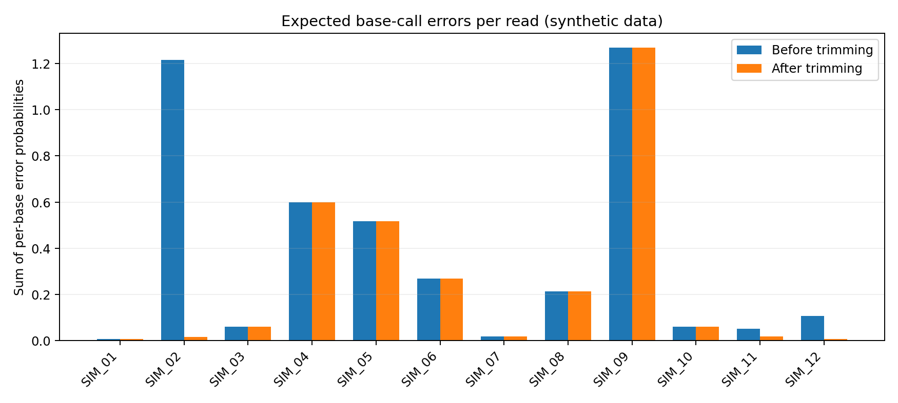

# NGS Sequencing QC Analysis 🐍🧬

<p align="center">
  
</p>

**Wolf Analytics | Python-based quality-control demonstration using synthetic FASTQ reads**

A small, readable, reproducible bioinformatics educational project that parses
FASTQ data, decodes Phred+33 quality scores, calculates read-level QC metrics,
compares per-base quality distributions, and demonstrates simple 3' quality
trimming. Designed to make the distinction between an *average quality score*
and the *expected burden of base-calling errors* transparent.

> **Scope:** All reads are **synthetic**. This is a **teaching and portfolio
> demonstration**, **not** a clinically or GMP-validated NGS analysis pipeline,
> a virus detection assay, or software used for patient/client decisions.
> This project is independent of and not affiliated with any employer or CRO.

## Example outputs





### Reproducible example (12 synthetic, 60-base reads)

| QC metric | Demo result |
|---|---:|
| Input reads | 12 |
| Input bases | 720 |
| Bases with Q ≥ 30 | 611 (84.86%) |
| Reads triggering illustrative *review* flags | 6 |
| Reads retained after example 3' trim + length rule | 12 |
| Bases trimmed from 3' tails | 14 |

**Key comparison:** SIM_02 and SIM_03 both have **arithmetic mean Q30**,
but SIM_02 contains 48 Q35 bases and 12 Q10 bases at the 3' tail. Their
respective expected error burdens are **1.21518** and **0.06000** per read.
That is approximately **20.25×** higher for SIM_02 despite the same mean Q.

## Quick start (Windows / Python 3.10+)

```powershell
# Open a terminal in the extracted repository folder:
py analyze_fastq.py

# Run the test suite:
py -m unittest discover -s tests -v
```

If your system uses `python` instead of `py`, use `python` in these commands.
The core QC script uses only the **Python standard library**.

To change input/parameters:

```powershell
py analyze_fastq.py --input data/synthetic_reads.fastq --outdir results --trim-q 20 --min-length 35
```

To **regenerate the two PNG plots** (optional matplotlib dependency):

```powershell
py -m pip install -r requirements-visuals.txt
py plot_qc.py
```

## Files

| Location | Purpose |
|---|---|
| `data/synthetic_reads.fastq` | 12 non-biological FASTQ records from a teaching dataset |
| `analyze_fastq.py` | CLI entry point |
| `ngs_qc/fastq.py` | FASTQ parser with basic input integrity checks |
| `ngs_qc/analysis.py` | Phred statistics, review flags, simple terminal trimming, reports |
| `tests/test_fastq_qc.py` | Unit and end-to-end tests |
| `results/qc_per_read.csv` | Per-read metrics, flags, pre/post trim comparison |
| `results/qc_by_position.csv` | Position-wise quality trend |
| `results/qc_summary.json` | Aggregate metrics and example parameter settings |
| `results/trimmed_reads.fastq` | Retained sequences following illustrative terminal trim |
| `assets/` | Publication-ready PNG figures generated from the CSVs |
| `docs/` | Scientific methods, limitations, and future development roadmap |


## Synthetic viral hit control review (educational extension, v1.1)

A separate, **control-aware review of hypothetical preclassified viral read
counts** illustrates extraction-blank comparison, RPM normalization, and
why a low-count sequence match is **not** a confirmed viral detection.

```powershell
py review_viral_controls.py --input data/synthetic_control_summary.csv --outdir results
```

The sample `CLIENT_A` contains 7 putative Virus_X reads in 1,200,000 total
reads (**5.8333 RPM**). Its extraction blank contains 2 in 500,000
(**4 RPM**). The ratio is **1.4583**, requiring contextual investigation,
**not** a positive/negative call. If the blank has zero putative hits, the
ratio is undefined, not an infinite signal. All rows are explicitly marked
for *technical review*, not regulatory disposition.

See [Control review methodology](docs/control_review_methodology.md) and
[example CSV output](results/viral_control_review.csv). The script accepts
**fictional alignment summary metrics as input**; it does not perform actual
FASTQ alignment or viral classification.

## Methods at a glance

- Phred base-call error estimate: `p(error) = 10^(-Q / 10)`.
- Read's expected base-call error count: `sum(p_i)`.
- Approximate probability of at least one erroneous base (independence
  assumption): `1 - product(1 - p_i)`.
- Review flags illustrate unexpectedly low Q30 fraction, elevated expected
  errors, poor terminal quality, or unresolved `N` bases. They are **not**
  assay acceptance thresholds.
- Terminal trimming removes only consecutive final bases below the chosen Q
  cutoff; it does **not** perform adapter trimming or eliminate internal errors.

See [Methodology and limitations](docs/scientific_notes.md) for assumptions and
[Development roadmap](docs/roadmap.md) for **not-yet-implemented** extensions.

## Verification

Run `py -m unittest discover -s tests -v` to verify numeric examples,
sequence parsing, trimming, FASTQ input errors, compressed input, and summary
output. The repository includes an optional GitHub Actions test workflow.

## Responsible use

No real clinical or client sequencing data are supplied. Never upload
patient-identifying or proprietary experimental data to a public repository.
A high Q score is an estimate of instrument base-calling accuracy, **not** proof
of biological provenance or the absence of contamination. No real-virus alignment, taxonomic classification, confirmed contamination
decision, or diagnostic reporting is performed here. The v1.1 control review
compares preclassified fictional read-count summaries only; v1.2 and v1.3
use invented reference and query sequences.

## Publishing

See [GitHub upload guide](GITHUB_UPLOAD_GUIDE.md) for simple steps using
GitHub Desktop or Git. Released under the MIT license.


## Version 1.2: Actual sequence-to-reference comparisons (synthetic)

This module performs **real character-by-character DNA comparisons** against
**entirely fictional** toy reference sequences; unlike v1.1, it does not rely
on preclassified alignment counts. It uses a deliberately simple ungapped
full-length matcher on both strands and identifies equally best placements.

```powershell
py align_synthetic_reads.py
py -m unittest discover -s tests -v
```

Outputs: `results/synthetic_reference_matches.csv` and
`results/synthetic_reference_summary.json`. The shared synthetic segment
produces an ambiguous cross-reference match, even at **100% sequence identity**.

**Not an actual production NGS aligner:** no calibrated mapping quality (MAPQ),
indels, biological reference database, virus identification, or validated
positive/negative calls. `mapq` is deliberately `NOT_CALCULATED`. See
[alignment methodology](docs/synthetic_alignment_methodology.md).


## Version 1.3: Gapped global/local alignments (synthetic)

A further standalone teaching module implements **Needleman-Wunsch** global
alignment and **Smith-Waterman** local alignment on invented, short DNA pairs.
It reports matches, substitutions, insertions and deletions relative to the
query, deterministic extended CIGAR-like operation strings, identity percentages,
and alignment coordinates.

```cmd
py align_gapped_synthetic.py
py -m unittest discover -s tests -v
```

Outputs: `results/synthetic_gapped_alignments.csv` and
`results/synthetic_gapped_summary.json`. No external Python libraries required.
The example `LOCAL_FLANKS` shows why local and global algorithms can select
different alignment spans. `HOMOPOLYMER_GAP` illustrates that one chosen gap
position is not proof of a unique alignment.

**Important limitations:** short synthetic pairs only, single optimal traceback,
linear gap costs, no reverse-strand search in this module, no MAPQ or biological
reference databases, and no clinical/GMP validation. See the
[Version 1.3 methods and verification notes](docs/gapped_alignment_methodology.md).

For a spreadsheet exercise, see the
[Version 1.3 Excel verification guide](docs/v1_3_excel_verification.md).
